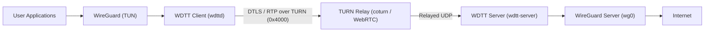

# WDTT Ecosystem (`wdtt-rs`)

[](https://github.com/KeylHenrih/WDTT-fork/actions/workflows/ci.yml)
[](LICENSE)
[](Cargo.toml)

**WDTT (`wdtt-rs`)** is an open-source network tunneling ecosystem designed to encapsulate standard WireGuard traffic into multimedia WebRTC call protocols (TURN/DTLS or RTP) to traverse restricted network environments with high packet loss and strict UDP filtering. The project **is not** an anonymity tool (such as Tor), does not provide public servers, does not conceal your traffic volume from your endpoint provider, and provides no guarantees of unblockable circumvention: it is a modular network transport mechanism connecting your personal client device to your private server via an intermediate relay.

---

## 1. Problem and Architecture

### What problem does it solve?
In mobile cellular networks and public Wi-Fi access points, standard WireGuard UDP datagrams are frequently throttled, signature-blocked at the handshake phase, or dropped entirely by Deep Packet Inspection (DPI) firewalls. In contrast, corporate video/voice conferencing traffic (WebRTC, TURN, DTLS, SRTP) is prioritized and forwarded unimpeded through intermediate media relays (TURN servers).

`wdtt-rs` addresses this challenge by encapsulating WireGuard datagrams into standard call media streams, enabling reliable transport between your device and your private endpoint.

### Tunnel Architecture:


### Participant Visibility:
- **Network Observer (Provider DPI):** Observes a standard WebRTC/DTLS 1.2 session with valid STUN Binding/Allocate handshakes and continuous fixed-interval media datagrams sent to known video conference relays. Inner WireGuard packets and destination endpoints are secured via double encryption.
- **Intermediate TURN Relay (e.g., VK / OK CDN or private Coturn):** Observes encrypted DTLS ApplicationData or RTP datagrams relayed between two authenticated endpoints. Inner packet contents, virtual IP addresses, and WireGuard session keys remain inaccessible to the relay.
- **Your Private Server:** Decapsulates datagrams, verifies cryptographic Pre-Auth Knock tokens, extracts inner WireGuard datagrams, and forwards them into the host Linux network stack.

---

## 2. Glossary

- **VPN (Virtual Private Network):** Technology that establishes an encrypted, secure virtual network tunnel across untrusted or public networks.
- **WireGuard:** A modern Layer 3 network protocol providing fast, verified end-to-end cryptography based on the Noise Protocol Framework (ChaCha20-Poly1305, Curve25519).
- **TURN (Traversal Using Relays around NAT, RFC 8656):** An IETF standard protocol enabling two endpoints behind symmetric NATs or restrictive firewalls to exchange datagrams via an intermediate relay.
- **DTLS (Datagram Transport Layer Security, RFC 6347):** A datagram-oriented security protocol providing confidentiality, authentication, and integrity guarantees for WebRTC communication.
- **DPI (Deep Packet Inspection):** Advanced traffic inspection systems used by network operators to identify, classify, and filter network protocols based on packet payloads and timing signatures.

---

## 3. Project Structure and Status

The project is currently under active development (Stage 4). All components are engineered from scratch in Rust (2024 edition) under GPL-3.0:

| Component | Location | Description | Implementation Status |
| :--- | :--- | :--- | :--- |
| **`wdtt-core`** | [`crates/core`](crates/core) | Core transport engine, adaptive resequencer, Knock pre-authentication | **Implemented** (ready for I/O batching) |
| **`wdtt-proto`** | [`crates/proto`](crates/proto) | WDTT v2 framing serialization, URL parsing for `wdtt://` and `qwdtt://` | **Implemented** (fuzz-tested) |
| **`wdtt-crypto`** | [`crates/crypto`](crates/crypto) | Pre-Auth Knock (ChaCha20-Poly1305), TTL Anti-Replay cache, KDF | **Implemented** (15 unit tests, proptest) |
| **`wdtt-turn`** | [`crates/turn`](crates/turn) | STUN/TURN client, ChannelData framing (RFC 8656), mock server | **Implemented** (live coturn test suite) |
| **`wdtt-server`** | [`crates/server`](crates/server) | Standalone server daemon for Linux (x86_64, aarch64 musl static) | **Implemented** (benchmarked at >1.8 Gbps) |
| **`wdttd`** | [`crates/daemon`](crates/daemon) | Client daemon for Linux, Windows, macOS | **Implemented** (verified with kernel WireGuard) |
| **`wdtt-ipc`** | [`crates/ipc`](crates/ipc) | IPC protocol between daemon and UI (Zero-Copy Postcard) | **Implemented** (base IPC schemas) |
| **`wdtt-gui`** | [`crates/gui-desktop`](crates/gui-desktop) | Lightweight native desktop GUI using Slint | **In Development** (scheduled for Stage 4) |
| **`wdtt-android`** | [`crates/ffi-android`](crates/ffi-android) | Kotlin Jetpack Compose UI + Rust Core (UniFFI / VpnService) | **In Development** (FFI builds in CI, UI in Stage 4) |

---

## 4. Performance Benchmarks and Measurements

All benchmarks below reflect reproducible hardware measurements ([docs/BENCHMARKS.md](docs/BENCHMARKS.md)) performed in isolated Linux network namespaces (`x86_64, 16 vCPU, Linux`, kernel 6.18, MTU 1200):

| Metric | Legacy Implementations (Architectural Code Audit) | `wdtt-rs` (Stage 3.5 Clean Testbed) | Engineering Reason |
| :--- | :--- | :--- | :--- |
| **Packet Loss under 35 ms Jitter** | Connection drop / TCP DupACK flood | **0.00% loss** (10/10 ICMP, WG Handshake OK) | Adaptive resequencer (`gap_timeout = 1.25*skew + 5ms`) |
| **Single-Stream TCP Throughput** | Throttled by Go runtime channel locks | **1846.02–1920.16 Mbits/s** | Zero-copy datapath and tuned socket buffers |
| **TCP Retransmits (10s run)** | >1000 retransmits on micro-bursts | **53–166 retransmits** | Micro-burst absorption and per-flow hashing |
| **Server CPU Utilization** | High (GC cycles, per-packet heap allocations) | **39.6% of 1 P-Core** (0.214 CPU-s / Gbit) | Zero heap allocations on hot forwarding path |
| **Process Memory (RSS)** | 40–90 MB (Go), 180–260 MB (Wails GUI) | **3.9 MB** (server), **4.0 MB** (client daemon) | Native binary footprint without embedded browser engines |
| **Active DPI Probe Reaction** | DTLS Alert / Handshake response | **0 bytes (Silent Discard)** | Pre-Auth Knock drops unauthorized probes prior to reply |

---

## 5. Quick Start: Building and Local Testing

### Prerequisites
- Rust toolchain: `rustc >= 1.85` (stable channel recommended: `rustup default stable`).
- For local end-to-end testbed: `coturn`, `wireguard-tools`, `iperf3`, `iproute2`.

### 5.1 Compiling
```bash
git clone https://github.com/KeylHenrih/WDTT-fork.git wdtt-rs
cd wdtt-rs

# Compile all workspace crates in release mode
cargo build --release

# Run unit and integration tests
cargo test --workspace
```

### 5.2 Running the Automated Local Testbed
A complete end-to-end benchmark script executing within network namespaces is included:
```bash
# Execute 10s benchmark with emulated TURN relay
python3 scripts/benchmark_tunnel.py --duration 10
```

### 5.3 Server Deployment Guide
The script `scripts/deploy_test_server.sh` prints an isolated deployment plan for system administrators (firewall append rules, unprivileged systemd services, rollback commands):
```bash
# Print dry-run server deployment plan (modifies nothing on host):
./scripts/deploy_test_server.sh
```

---

## 6. Threat Model and Limitations

1. **Traffic Analysis:** Network observers can measure packet sizes, transmission timings, and the public IP address of the intermediate TURN relay. Resistance against advanced side-channel statistical correlation is not guaranteed in current versions.
2. **Third-Party Relay Dependency:** If an external relay infrastructure revokes access tokens, flags accounts, or applies strict bandwidth throttling (`STUN 486`), tunnel performance will be bound to relay constraints.
3. **Endpoint Cryptographic Integrity:** Security relies on the integrity of private WireGuard keys and the Pre-Auth Knock secret. Compromise of either key permits unauthorized traffic decryption or injection.

---

## 7. Legal Disclaimer

- **No Affiliation:** This project is an independent open-source research initiative and is not affiliated with, endorsed by, or sponsored by VK, Mail.ru, OK CDN, or any third-party telecommunications provider.
- **Terms of Service:** Using third-party infrastructure (such as video call servers) in manners outside their intended scope or terms of service may violate platform agreements and lead to account restrictions.
- **Compliance:** Legal regulations regarding encryption, VPN protocols, and network bypass technologies vary by country. The end user assumes sole responsibility for compliance with all applicable laws.
- **No Warranty:** The software is provided under the GNU General Public License v3.0 on an "AS IS" basis, without warranties or conditions of any kind.

---

## 8. Frequently Asked Questions (FAQ)

<details>
<summary><b>How does WDTT v2 differ from earlier implementations?</b></summary>

WDTT v2 is built from scratch in Rust, features deterministic per-flow hashing (preventing out-of-order packet delivery), an adaptive WireGuard resequencer, cryptographic Pre-Auth Knock probe protection, and requires a fraction of the CPU and memory footprint of legacy implementations.
</details>

<details>
<summary><b>Does this project use code from CSQTT?</b></summary>

**No.** CSQTT is released under the PolyForm Noncommercial license, which is incompatible with GPL-3.0. Not a single line of code from CSQTT is used in `wdtt-rs`: the implementation was authored independently according to open specifications.
</details>

<details>
<summary><b>Can I run a private TURN server instead of public services?</b></summary>

**Yes.** The architecture is decoupled from any specific provider. You can host an instance of `coturn` on a personal VPS and route traffic through it for optimal throughput and predictability.
</details>

---

## 9. License and Contributing

- The project source code is licensed under the **GNU General Public License v3.0 (GPL-3.0-only)**. See [LICENSE](LICENSE) for the full text.
- Third-party dependency licenses are cataloged in [THIRD_PARTY.md](THIRD_PARTY.md) and [NOTICE](NOTICE).
- Guidelines for development and pull requests are detailed in [CONTRIBUTING.md](CONTRIBUTING.md).
- Security vulnerability reporting procedures are provided in [SECURITY.md](SECURITY.md).
