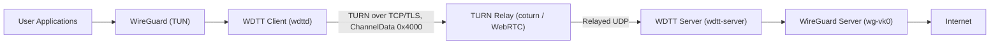

# WDTT Ecosystem (`wdtt-rs`)

[](https://github.com/KeylHenrih/WDTT-fork/actions/workflows/ci.yml)
[](LICENSE)
[](Cargo.toml)

**WDTT (`wdtt-rs`)** is an open-source network tunneling ecosystem designed to encapsulate standard WireGuard traffic into multimedia WebRTC call protocols (TURN over TCP/TLS, ChannelData) to traverse restricted network environments with high packet loss and strict UDP filtering. The project **is not** an anonymity tool (such as Tor), does not provide public servers, does not conceal your traffic volume from your endpoint provider, and provides no guarantees of unblockable circumvention: it is a modular network transport mechanism connecting your personal client device to your private server via an intermediate relay.

---

## 1. Problem and Architecture

### What problem does it solve?
In mobile cellular networks and public Wi-Fi access points, standard WireGuard UDP datagrams are frequently throttled, signature-blocked at the handshake phase, or dropped entirely by Deep Packet Inspection (DPI) firewalls. In contrast, corporate video/voice conferencing traffic (WebRTC, TURN, DTLS, SRTP) is prioritized and forwarded unimpeded through intermediate media relays (TURN servers).

`wdtt-rs` addresses this challenge by encapsulating WireGuard datagrams into standard call media streams, enabling reliable transport between your device and your private endpoint.

### Tunnel Architecture:


### Participant Visibility:
- **Network Observer (Provider DPI):** Observes a standard WebRTC/DTLS 1.2 session with valid STUN Binding/Allocate handshakes and a continuous stream of fixed-format media datagrams sent to known video conference relays. Inner WireGuard packets and destination endpoints are secured via double encryption.
- **Intermediate TURN Relay (e.g., VK / OK CDN or private Coturn):** Observes an encrypted TURN ChannelData stream relayed between two authenticated endpoints. Inner packet contents, virtual IP addresses, and WireGuard session keys remain inaccessible to the relay.
- **Your Private Server:** Decapsulates datagrams, verifies cryptographic Pre-Auth Knock tokens, extracts inner WireGuard datagrams, and forwards them into the host Linux network stack.

---

## 2. Glossary

- **VPN (Virtual Private Network):** Technology that establishes an encrypted, secure virtual network tunnel across untrusted or public networks.
- **WireGuard:** A modern Layer 3 network protocol providing fast, verified end-to-end cryptography based on the Noise Protocol Framework (ChaCha20-Poly1305, Curve25519).
- **TURN (Traversal Using Relays around NAT, RFC 8656):** An IETF standard protocol enabling two endpoints behind symmetric NATs or restrictive firewalls to exchange datagrams via an intermediate relay.
- **DTLS (Datagram Transport Layer Security, RFC 6347):** A datagram-oriented security protocol providing confidentiality, authentication, and integrity guarantees for WebRTC communication.
- **DPI (Deep Packet Inspection):** Advanced traffic inspection systems used by network operators to identify, classify, and filter network protocols based on packet payloads and timing signatures.

---

## 3. Project Structure and Status

The project is currently under active development. All components are engineered from scratch in Rust (2024 edition) under GPL-3.0. The Linux client and server are functionally complete (transport, routing, DNS, host management); the graphical interface and the Android client remain at the scaffold stage.

| Component | Location | Description | Implementation Status |
| :--- | :--- | :--- | :--- |
| **`wdtt-core`** | [`crates/core`](crates/core) | Core transport engine, stream pool, resequencer, keepalive, reconnect, TUN datapath | **Implemented** |
| **`wdtt-proto`** | [`crates/proto`](crates/proto) | WDTT v2 framing serialization, URL parsing for `wdtt://` and `qwdtt://` | **Implemented** (fuzz-tested) |
| **`wdtt-crypto`** | [`crates/crypto`](crates/crypto) | Pre-Auth Knock (ChaCha20-Poly1305), TTL Anti-Replay cache, KDF | **Implemented** |
| **`wdtt-turn`** | [`crates/turn`](crates/turn) | STUN/TURN client, ChannelData framing (RFC 8656), stream pool, mock server | **Implemented** (live coturn test suite) |
| **`wdtt-tun`** | [`crates/tun`](crates/tun) | Host management: policy routing, nftables, kill-switch, DNS forwarder, geo data, xray-compatible routing | **Implemented** (Linux) |
| **`wdtt-provider`** | [`crates/provider`](crates/provider) | TURN credential provider factory with on-disk cache | **Implemented** |
| **`wdtt-server`** | [`crates/server`](crates/server) | Standalone server daemon for Linux (x86_64, aarch64 musl static) | **Implemented** (>1.8 Gbps on the testbed) |
| **`wdttd`** | [`crates/daemon`](crates/daemon) | Client daemon for Linux | **Implemented** (verified with kernel WireGuard) |
| **`wdtt-ipc`** | [`crates/ipc`](crates/ipc) | IPC protocol between daemon and UI | **Implemented** (base schemas) |
| **`wdtt-gui`** | [`crates/gui-desktop`](crates/gui-desktop) | Native desktop GUI using Slint | **In Development** (scaffold) |
| **`wdtt-android`** | [`crates/ffi-android`](crates/ffi-android) | Kotlin Jetpack Compose UI + Rust Core (UniFFI / VpnService) | **In Development** (FFI builds in CI) |

### 3.1 Implemented Client Mechanisms

- **Parallel TURN stream pool.** Several TURN streams are established at once, each served by its own task, so congestion on one stream does not stall the others.
- **Transport reconnect.** Losing a stream does not terminate the process: the client re-establishes the pool and keeps running.
- **TURN credential refresh.** Relay credentials are refreshed before they expire; on an authorization failure the pool is re-established with a single retry.
- **Connect timeout.** Stream establishment is bounded from above, so an unreachable relay cannot hang startup.
- **Policy routing.** Packets selected by the rules are marked in nftables and sent into a separate routing table through the TUN interface; all other traffic follows the normal path.
- **Kill-switch.** Packets marked for the tunnel that leave the host through another interface are dropped. It is implemented as its own nftables table and does not touch other applications' rules.
- **`outboundTag: "block"` rules.** Compiled into real drop rules in a separate nftables table, independent of the marking table.
- **DNS forwarder.** A local resolver that restores the system settings on shutdown.
- **Geo data and xray-compatible routing.** Parsing of `geoip:`/`geosite:` categories and of a rule configuration compatible with xray.
- **Ordered setup with rollback.** Host configuration runs step by step and rolls back if any step fails.

---

## 4. Performance Benchmarks and Measurements

All benchmarks below reflect reproducible hardware measurements ([docs/BENCHMARKS.md](docs/BENCHMARKS.md)) performed in isolated Linux network namespaces (`x86_64, 16 vCPU, Linux`, kernel 6.18, MTU 1200). They characterise the transport core at the time of measurement and are given as a historical reference point, not as a performance guarantee on arbitrary hardware:

| Metric | Legacy Implementations (Architectural Code Audit) | `wdtt-rs` (Measured Testbed) | Engineering Reason |
| :--- | :--- | :--- | :--- |
| **Packet Loss under 35 ms Jitter** | Connection drop / TCP DupACK flood | **0.00% loss** (10/10 ICMP, WG Handshake OK) | Adaptive resequencer (`gap_timeout = 1.25*skew + 5ms`) |
| **Single-Stream TCP Throughput** | Throttled by Go runtime channel locks | **1846.02–1920.16 Mbits/s** | Zero-copy datapath and tuned socket buffers |
| **TCP Retransmits (10s run)** | >1000 retransmits on micro-bursts | **53–166 retransmits** | Micro-burst absorption and per-flow hashing |
| **Server CPU Utilization** | High (GC cycles, per-packet heap allocations) | **39.6% of 1 P-Core** (0.214 CPU-s / Gbit) | Zero heap allocations on hot forwarding path |
| **Process Memory (RSS)** | 40–90 MB (Go), 180–260 MB (Wails GUI) | **3.9 MB** (server), **4.0 MB** (client daemon) | Native binary footprint without embedded browser engines |
| **Active DPI Probe Reaction** | DTLS Alert / Handshake response | **0 bytes (Silent Discard)** | Pre-Auth Knock drops unauthorized probes prior to reply |

### 4.1 Profiles and Keepalive Modes

- **PowerSave (default):** adaptive probing with Pong feedback loop (start 20s, step +2s, ceiling 25s, floor 10s) and non-reversible network identity caching (`NetworkId`). Guarantees near-zero idle load (0.05 wakeups/s) and maximum battery preservation.
- **Chaff [Experimental]:** continuous Opus voice codec emulation (50 pps @ 20ms) with variable random padding (60–140 bytes) to defeat heuristic DPI classification. Incurs non-trivial context switch cost (~115.8 CS/s) and keeps cellular modems from entering C-DRX low-power states; enabled strictly via `--keepalive chaff`.

---

## 5. Quick Start: Building and Local Testing

### Prerequisites
- Rust toolchain: `rustc >= 1.85` (stable channel recommended: `rustup default stable`).
- For local end-to-end testbed: `coturn`, `wireguard-tools`, `iperf3`, `iproute2`, `nftables`.

### 5.1 Compiling
```bash
git clone https://github.com/KeylHenrih/WDTT-fork.git
cd WDTT-fork

# Compile all workspace crates in release mode
cargo build --release

# Run unit and integration tests
cargo test --workspace
```

> [!NOTE]
> Repository URL references in the tree use the `<REPO_URL>` placeholder. Run `scripts/set_repo_url.sh <URL>` with the real address before building a release.

### 5.2 Running the Automated Local Testbed
A complete end-to-end benchmark script executing within network namespaces is included:
```bash
# Execute 10s benchmark with emulated TURN relay
python3 scripts/benchmark_tunnel.py --duration 10
```

### 5.3 Server Deployment Scripts
The `scripts/` directory collects helper scripts for installing and removing the server side (`install_vk_server.sh`, `uninstall_vk_server.sh`, `deploy_test_server.sh`, and others). The deployment script prints a step-by-step plan for administrators (targeted firewall rules, running coturn and the server as an unprivileged user, rollback commands):
```bash
# Print dry-run server deployment plan (modifies nothing on host):
./scripts/deploy_test_server.sh
```

---

## 6. Threat Model and Limitations

1. **Traffic Analysis:** Network observers can measure packet sizes, transmission timings, and the public IP address of the intermediate TURN relay. Resistance against advanced side-channel statistical correlation is not guaranteed in current versions.
2. **Third-Party Relay Dependency:** If an external relay infrastructure revokes access tokens, flags accounts, or applies strict bandwidth throttling (`STUN 486`), tunnel performance will be bound to relay constraints.
3. **Endpoint Cryptographic Integrity:** Security relies on the integrity of private WireGuard keys and the Pre-Auth Knock secret. Compromise of either key permits unauthorized traffic decryption or injection.
4. **Undocumented TURN Acquisition Procedure:** The part of the protocol that obtains TURN credentials from a third-party platform (request order, token format, binding to the call session) is a **reconstruction from observed client behaviour**, not an official specification. This procedure is undocumented by the vendor, may change or be disabled at any time without notice, and if that happens the corresponding provider stops working until the code is updated. The modular architecture (`crates/provider`) allows replacing or supplementing this provider with another source of TURN access.
5. **Platform Account Risk:** Using a third-party platform account to relay non-target traffic may lead to restriction, blocking, or deletion of that account. Use a separate account not tied to personal data, and do not rely on its continued availability.
6. **User Responsibility:** The project provides a transport mechanism and does not operate the relay infrastructure. Choosing a relay, complying with its terms of use, and assessing legal risk remain the user's responsibility.

---

## 7. Legal Disclaimer

- **No Affiliation:** This project is an independent open-source research initiative and is not affiliated with, endorsed by, or sponsored by VK, Mail.ru, OK CDN, or any third-party telecommunications provider.
- **Terms of Service:** Using third-party infrastructure (such as video call servers) in manners outside their intended scope or terms of service may violate platform agreements and lead to account restrictions.
- **Compliance:** Legal regulations regarding encryption, VPN protocols, and network bypass technologies vary by country. The end user assumes sole responsibility for compliance with all applicable laws.
- **No Warranty:** The software is provided under the GNU General Public License v3.0 on an "AS IS" basis, without warranties or conditions of any kind.

---

## 8. Frequently Asked Questions (FAQ)

<details>
<summary><b>How does WDTT v2 differ from earlier implementations?</b></summary>

WDTT v2 is built from scratch in Rust, features deterministic per-flow hashing (preventing out-of-order packet delivery), an adaptive WireGuard resequencer, cryptographic Pre-Auth Knock probe protection, and requires a fraction of the CPU and memory footprint of legacy implementations.
</details>

<details>
<summary><b>Does this project use code from CSQTT?</b></summary>

**No.** CSQTT is released under the PolyForm Noncommercial license, which is incompatible with GPL-3.0. Not a single line of code from CSQTT is used in `wdtt-rs`: the implementation was authored independently according to open specifications.
</details>

<details>
<summary><b>Can I run a private TURN server instead of public services?</b></summary>

**Yes.** The architecture is decoupled from any specific provider. You can host an instance of `coturn` on a personal VPS and route traffic through it for optimal throughput and predictability.
</details>

---

## 9. License and Contributing

- The project source code is licensed under the **GNU General Public License v3.0 (GPL-3.0-only)**. See [LICENSE](LICENSE) for the full text.
- Third-party dependency licenses are cataloged in [THIRD_PARTY.md](THIRD_PARTY.md) and [NOTICE](NOTICE).
- Guidelines for development and pull requests are detailed in [CONTRIBUTING.md](CONTRIBUTING.md).
- Security vulnerability reporting procedures are provided in [SECURITY.md](SECURITY.md).
