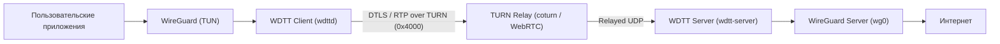

# WDTT Ecosystem (`wdtt-rs`)

[](https://github.com/KeylHenrih/WDTT-fork/actions/workflows/ci.yml)
[](LICENSE)
[](Cargo.toml)

**WDTT (`wdtt-rs`)** — открытая экосистема сетевого туннелирования, инкапсулирующая стандартный трафик WireGuard в протоколы мультимедийных WebRTC-вызовов (TURN/DTLS или RTP) для прохождения через ограниченные сетевые среды с высоким уровнем потерь и строгой фильтрацией UDP. Проект **не является** средством анонимизации (таким как Tor), не предоставляет публичных серверов, не скрывает факт передачи трафика от оператора вашей конечной точки и не даёт гарантий непрерывного обхода блокировок: это модульный сетевой транспорт для связи вашего личного устройства с вашим личным сервером через промежуточный релей.

---

## 1. Проблема и принцип работы

### Какую проблему решает проект?
В сотовых сетях и сетях публичного Wi-Fi стандартные UDP-пакеты WireGuard часто подвергаются избирательному замедлению (throttling), блокировкам по сигнатуре handshake-пакета или полному отбрасыванию протоколами DPI. В то же время голосовой и видео-трафик корпоративных платформ и мессенджеров (WebRTC, TURN, DTLS, SRTP) пользуется приоритетом доставки и беспрепятственно маршрутизируется через промежуточные медиа-релеи (TURN-серверы).

`wdtt-rs` решает задачу надёжной доставки трафика между вашим клиентом и вашим собственным сервером, упаковывая WireGuard-дейтаграммы в легитимный медиапоток звонка.

### Архитектура туннеля:


### Что видят участники обмена:
- **Сетевой наблюдатель (DPI провайдера):** видит стандартную сессию WebRTC/DTLS 1.2 с легитимным обменом STUN Binding/Allocate и непрерывным потоком медиа-дейтаграмм фиксированного формата на известные адреса видеосерверов. Внутренний трафик WireGuard и посещаемые ресурсы скрыты двойным шифрованием.
- **Промежуточный TURN-релей (например, VK / OK CDN или Coturn):** видит зашифрованный поток DTLS ApplicationData или RTP-дейтаграмм между двумя авторизованными клиентами. Содержимое пакетов, внутренние IP-адреса и ключи WireGuard релею недоступны.
- **Ваш личный сервер:** принимает расшифрованные дейтаграммы, проверяет криптографический маркер авторизации (Pre-Auth Knock), распаковывает пакеты WireGuard и направляет их в стандартный сетевой стек Linux.

---

## 2. Глоссарий терминов

- **VPN (Virtual Private Network):** технология создания защищённого виртуального сетевого соединения поверх открытых и ненадежных каналов связи.
- **WireGuard:** современный криптографический протокол сетевого уровня (Layer 3), обеспечивающий высокую скорость и строгую аутентификацию на базе Noise Protocol Framework (ChaCha20-Poly1305, Curve25519).
- **TURN (Traversal Using Relays around NAT, RFC 8656):** стандартизированный сетевой протокол, позволяющий двум узлам за строгими NAT и файрволами обмениваться дейтаграммами через промежуточный узел ретрансляции.
- **DTLS (Datagram Transport Layer Security, RFC 6347):** протокол канального шифрования для дейтаграмм, аналогичный TLS для TCP, обеспечивающий аутентификацию, целостность и конфиденциальность пакетов WebRTC.
- **DPI (Deep Packet Inspection):** аппаратно-программные комплексы сетевых операторов, анализирующие заголовки и статистические свойства пакетов для идентификации и ограничения протоколов.

---

## 3. Состав проекта и текущий статус

Проект находится в стадии активной разработки (Этап 4). Все компоненты разрабатываются с нуля на языке Rust (Edition 2024) под лицензией GPL-3.0:

| Компонент | Расположение | Описание | Статус реализации |
| :--- | :--- | :--- | :--- |
| **`wdtt-core`** | [`crates/core`](crates/core) | Транспортный движок, адаптивный ресеквенсер, Knock-аутентификация | **Реализовано** (готов к интеграции батчинга I/O) |
| **`wdtt-proto`** | [`crates/proto`](crates/proto) | Сериализация кадров WDTT v2, парсер ссылок `wdtt://` и `qwdtt://` | **Реализовано** (покрыто fuzz-тестами) |
| **`wdtt-crypto`** | [`crates/crypto`](crates/crypto) | Pre-Auth Knock (ChaCha20-Poly1305), TTL Anti-Replay кеш, KDF | **Реализовано** (15 unit-тестов, proptest) |
| **`wdtt-turn`** | [`crates/turn`](crates/turn) | Клиент STUN/TURN, ChannelData (RFC 8656), mock-сервер | **Реализовано** (тесты с реальным coturn) |
| **`wdtt-server`** | [`crates/server`](crates/server) | Серверный демон для Linux (x86_64, aarch64 musl static) | **Реализовано** (протестирован на скоростях >1.8 Гбит/с) |
| **`wdttd`** | [`crates/daemon`](crates/daemon) | Клиентский демон для Linux, Windows, macOS | **Реализовано** (проверен в связке с ядром WireGuard) |
| **`wdtt-ipc`** | [`crates/ipc`](crates/ipc) | Межпроцессное взаимодействие UI и демона (Zero-Copy Postcard) | **Реализовано** (базовая схема IPC) |
| **`wdtt-gui`** | [`crates/gui-desktop`](crates/gui-desktop) | Легковесный графический интерфейс на Slint | **В разработке** (запланирован на Этап 4) |
| **`wdtt-android`** | [`crates/ffi-android`](crates/ffi-android) | Kotlin Jetpack Compose UI + Rust Core (UniFFI / VpnService) | **В разработке** (каркас FFI собран в CI, UI на Этапе 4) |

---

## 4. Сравнение производительности и подтверждённые замеры

Все приведённые ниже данные получены в ходе воспроизводимых аппаратных измерений ([docs/BENCHMARKS.md](docs/BENCHMARKS.md)) на тестовом стенде (`x86_64, 16 vCPU, Linux`, ядро 6.18, сетевые пространства имён, канал MTU 1200):

| Метрика | Существующие Go-реализации (Архитектурная оценка / код) | `wdtt-rs` (Этап 3.5, измеренный стенд) | За счёт чего достигнуто |
| :--- | :--- | :--- | :--- |
| **Потери пакетов при джиттере 35 мс** | Сброс соединения / лавина TCP DupACK | **0.00% потерь** (10/10 ICMP, WG Handshake OK) | Адаптивный ресеквенсер (`gap_timeout = 1.25*skew + 5ms`) |
| **Пропускная способность 1 TCP-потока** | Ограничена блокировками runtime Go | **1846.02–1920.16 Мбит/с** | Zero-copy архитектура и тюнинг очередей сокетов |
| **Ретрансмиты TCP на 10 с потоке** | >1000 ретрансмитов при микропачках | **53–166 ретрансмитов** | Буферизация пачек и попоточное Flow-сохранение |
| **Загрузка процессора сервера** | Высокая (GC Go, аллокации в цикле) | **39.6% одного P-ядра** (0.214 CPU-с / Гбит) | Отсутствие аллокаций памяти на горячем пути |
| **Память процесса (RSS)** | 40–90 МБ (Go), 180–260 МБ (Wails GUI) | **3.9 МБ** (сервер), **4.0 МБ** (клиентский демон) | Компактный нативный бинарник без браузерных движков |
| **Active DPI Probe Reaction** | Ответ DTLS Alert / Handshake | **0 байт (Silent Discard)** | Pre-Auth Knock отбрасывает зонды до ответа |

### 4.1 Профили работы и режимы Keepalive

- **PowerSave (по умолчанию):** адаптивное зондирование с обратной связью (старт 20 с, шаг +2 с, потолок 25 с, пол 10 с) с кешированием сети (`NetworkId`). Обеспечивает нулевую нагрузку в покое (0.05 wakeups/с) и максимальное сохранение заряда батареи.
- **Chaff [Экспериментальный]:** непрерывная эмуляция аудиокодека Opus (50 pps @ 20 мс) со случайным паддингом (60–140 байт) для обхода эвристического DPI. Имеет высокую цену по переключениям контекста (~115.8 CS/с), вызывает постоянное радио-бужение сотового модема и повышенный расход батареи; включается только флагом `--keepalive chaff`.

---

## 5. Быстрый старт: сборка и запуск тестового стенда

### Требования
- Компилятор Rust: `rustc >= 1.85` (рекомендуется стабильный канал `rustup default stable`).
- Для запуска локального стенда: `coturn`, `wireguard-tools`, `iperf3`, `iproute2`.

### 5.1 Сборка проекта
```bash
git clone https://github.com/KeylHenrih/WDTT-fork.git
cd wdtt-rs

# Сборка всех компонентов в релизном режиме
cargo build --release

# Запуск тестов рабочего пространства
cargo test --workspace
```

### 5.2 Автоматический запуск тестового стенда
В репозиторий включён скрипт локального сквозного тестирования в изолированных сетевых пространствах имён:
```bash
# Запуск сквозного бенчмарка с эмуляцией TURN-релея
python3 scripts/benchmark_tunnel.py --duration 10
```

### 5.3 Развёртывание на сервере
Скрипт `scripts/deploy_test_server.sh` формирует безопасный пошаговый план команд для системного администратора (добавление точечных правил фаервола, запуск coturn и сервера от непривилегированного пользователя, команды отката):
```bash
# Просмотр плана развёртывания (dry-run, ничего не изменяет в системе):
./scripts/deploy_test_server.sh
```

---

## 6. Модель угроз и ограничения

1. **Видимость трафика:** Провайдер сети видит объём переданных данных, тайминги пакетов и IP-адрес используемого TURN-релея. Защита от расширенного корреляционного анализа по таймингам пакетов (traffic analysis / side-channel) в текущей версии не гарантируется.
2. **Зависимость от инфраструктуры релея:** Если промежуточный TURN-сервер блокирует аккаунт, отзывает токен звонка или вводит строгие ограничения полосы пропускания (`STUN 486`), скорость туннеля снижается до лимитов платформы.
3. **Безопасность конечной точки:** Безопасность туннеля опирается на криптографическую стойкость ключей WireGuard и разделяемого секрета Pre-Auth Knock. Компрометация ключа на клиенте или сервере делает возможной подмену трафика.
4. **Недокументированность процедуры получения TURN-доступа:** Часть протокола, описывающая получение учётных данных TURN у сторонней платформы (порядок запросов, формат токена, привязка к сессии звонка), является **реконструкцией по наблюдению за поведением клиента**, а не официальной спецификацией. Эта процедура не документирована поставщиком, может быть изменена или отключена в любой момент без предупреждения, и в этом случае соответствующий провайдер перестанет работать до обновления кода. Модульная архитектура проекта (`crates/provider`) позволяет заменить или дополнить этот провайдер другим источником TURN-доступа.
5. **Риски для учётной записи на стороне платформы:** Использование учётной записи сторонней платформы для ретрансляции нецелевого трафика может привести к ограничению, блокировке или удалению этой учётной записи. Рекомендуется использовать отдельную учётную запись, не связанную с личными данными, и не полагаться на её сохранность.
6. **Ответственность пользователя:** Проект предоставляет транспортный механизм и не управляет инфраструктурой релея. Выбор релея, соблюдение его условий использования и оценка правовых рисков остаются на стороне пользователя.

---

## 7. Юридическая информация и отказ от ответственности

- **Отсутствие аффилированности:** Настоящий программный комплекс является независимой разработкой с открытым исходным кодом и не связан, не спонсируется и не одобрен корпорацией VK, Mail.ru, OK CDN или какими-либо другими сторонними поставщиками услуг связи.
- **Условия обслуживания (Terms of Service):** Использование публичной серверной инфраструктуры сторонних платформ (включая серверы видеозвонков) в целях, не предусмотренных их пользовательскими соглашениями, может нарушать правила соответствующих сервисов и приводить к ограничению доступа.
- **Законодательное регулирование:** Правовой статус использования технологий VPN и средств обхода сетевых ограничений зависит от юрисдикции страны вашего нахождения. Вся ответственность за соблюдение применимого законодательства лежит исключительно на конечном пользователе.
- **Отказ от гарантий:** Программное обеспечение предоставляется по лицензии GPL-3.0 на условиях «КАК ЕСТЬ» (AS IS), без каких-либо явных или подразумеваемых гарантий пригодности для конкретных целей.

---

## 8. Часто задаваемые вопросы (FAQ)

<details>
<summary><b>Чем WDTT v2 отличается от предыдущих форков (PWDTT, qWDTT)?</b></summary>

WDTT v2 полностью переписан на Rust, использует поточное Flow-хэширование (устраняющее рассинхронизацию TCP), адаптивный ресеквенсер пакетов WireGuard, предварительную knock-аутентификацию (защищающую от активного DPI-сканирования портов) и потребляет на порядок меньше памяти и ресурсов CPU.
</details>

<details>
<summary><b>Используется ли в проекте код CSQTT?</b></summary>

**Нет.** Проект CSQTT распространяется под лицензией PolyForm Noncommercial, несовместимой с GPL. В `wdtt-rs` не заимствовано ни одной строки кода из CSQTT: реализация выполнена полностью независимо по открытой спецификации.
</details>

<details>
<summary><b>Можно ли использовать собственный TURN-сервер вместо публичных сервисов?</b></summary>

**Да.** Движок спроектирован полностью независимым от внешних API. Вы можете поднять собственный `coturn` на любом VPS и туннелировать трафик через него с максимальной скоростью и стабильностью.
</details>

---

## 9. Лицензия и вклад в проект

- Исходный код проекта распространяется под лицензией **GNU General Public License v3.0 (GPL-3.0-only)**. Полный текст лицензии доступен в файле [LICENSE](LICENSE).
- Лицензии сторонних библиотек и компонентов зафиксированы в [THIRD_PARTY.md](THIRD_PARTY.md) и [NOTICE](NOTICE).
- Правила участия в разработке и стандарты кода описаны в [CONTRIBUTING.md](CONTRIBUTING.md).
- Политика сообщений об уязвимостях приведена в [SECURITY.md](SECURITY.md).
